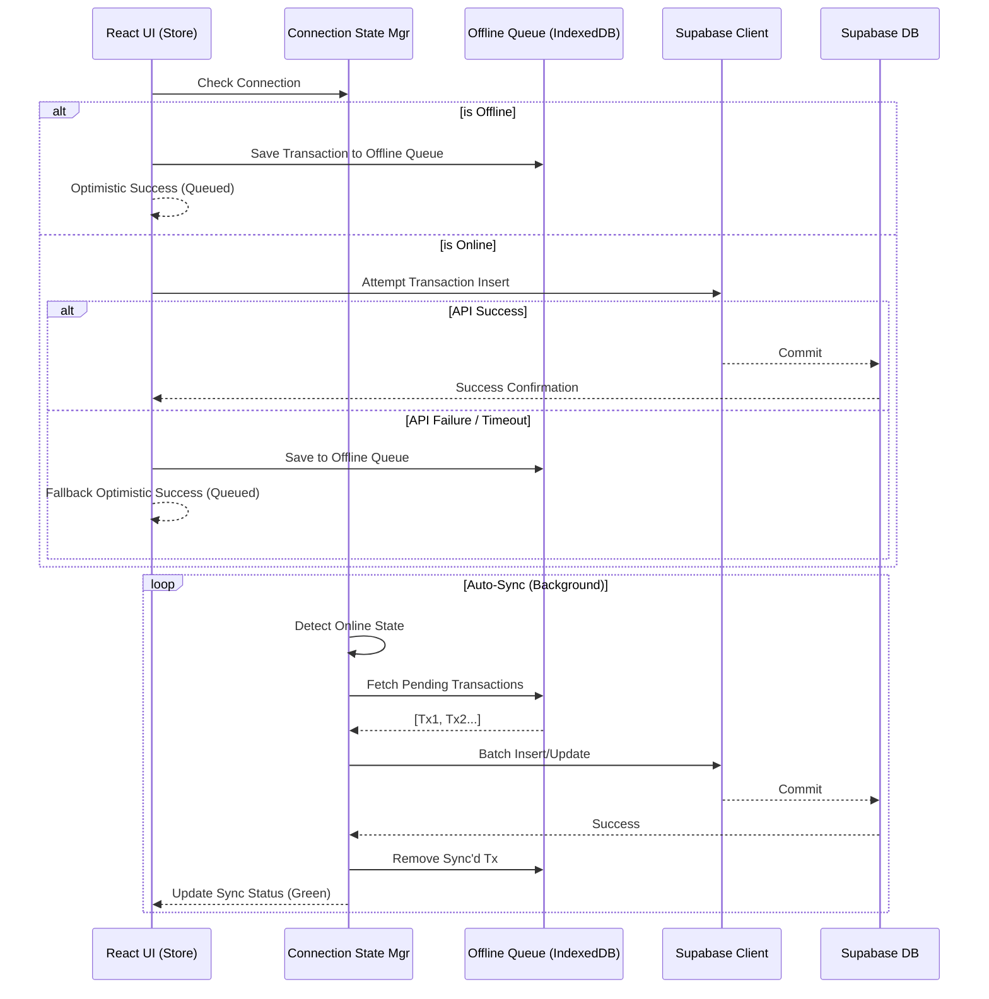

# Technical Design Document: init-creditambar-pwa

## Technical Approach
This project establishes the foundation for the CreditAmbar Progressive Web App (PWA), a system designed for managing credit transactions in environments with unreliable connectivity. The application follows an offline-first architecture leveraging React, Vite, and Supabase. The core mechanism involves a local-first queue using Dexie.js to store transactions offline and synchronize them with Supabase when connectivity is restored. The UI will adopt an iOS Liquid Glass aesthetic via Tailwind CSS.

## Architecture Decisions

### 1. Local-first Offline Data Sync
*   **Choice:** Dexie.js for IndexedDB local queueing.
*   **Alternatives Considered:** Redux Offline, direct localForage, Workbox Sync.
*   **Rationale:** Dexie.js provides a robust, type-safe API for IndexedDB. Given the requirement to ensure no transaction loss during offline operation, a dedicated Dexie.js queue combined with a custom sync manager offers granular control over retries, optimistic UI updates, and conflict resolution over Workbox background sync which is less predictable across browsers (specifically iOS Safari).

### 2. Styling and UI Language
*   **Choice:** Tailwind CSS with custom iOS Liquid Glass tokens.
*   **Alternatives Considered:** Material UI, Chakra UI, raw CSS modules.
*   **Rationale:** Tailwind enables rapid construction of the highly specific "Liquid Glass" aesthetic (translucency, backdrop-blur, subtle borders) required without the overhead of overriding heavily opinionated component libraries.

### 3. Authentication and Session Management
*   **Choice:** Store shared session + Cashier PIN.
*   **Alternatives Considered:** Individual Supabase user accounts per cashier, OAuth providers.
*   **Rationale:** For retail environments where multiple cashiers share a single device, a shared device session (authenticated once via Supabase) coupled with lightweight in-app Cashier PIN checks provides a smoother UX and faster user switching without heavy logout/login cycles.

### 4. Cash Flow Control (FCC)
*   **Choice:** Cash FCC isolation logic.
*   **Alternatives Considered:** Combined asset ledger.
*   **Rationale:** Isolating cash flows ensures that cash on hand exactly matches the cash ledger, facilitating end-of-day reconciliation and reducing accounting discrepancies.

### 5. Transaction Mutability
*   **Choice:** 10-minute grace window for transaction edits/cancellations.
*   **Alternatives Considered:** Immutable transactions (append-only ledgers), unlimited edit windows.
*   **Rationale:** Human errors (e.g., typos in amounts) occur at the point of sale. A 10-minute window allows immediate correction without complex reversal flows, while still locking historical data for audit and security purposes.

## Data Flow



## File Changes

| File / Path | Action | Description |
| :--- | :--- | :--- |
| `src/main.tsx` | Create | React application entry point, registers PWA service worker. |
| `src/App.tsx` | Create | Root component, sets up routing and global providers. |
| `src/lib/dexie.ts` | Create | Dexie.js database definition and schema. |
| `src/lib/supabase.ts` | Create | Supabase client initialization. |
| `src/lib/syncManager.ts` | Create | Logic for monitoring network state and processing Dexie queue. |
| `src/store/authStore.ts` | Create | Zustand store for shared session and Cashier PIN state. |
| `src/components/ui/` | Create | Reusable UI components styled with Liquid Glass tokens. |
| `src/features/transactions/` | Create | Transaction entry forms, history views, and logic. |
| `tailwind.config.js` | Create | Tailwind configuration including custom glass utilities. |
| `supabase/migrations/` | Create | SQL migration files for DDL and RLS policies. |

## Interfaces / Contracts

### TypeScript Interfaces

```typescript
// src/types/database.ts

export interface Profile {
  id: string; // UUID references auth.users
  store_name: string;
  created_at: string;
}

export interface Customer {
  id: string; // UUID
  name: string;
  phone?: string;
  credit_limit: number;
  balance: number;
  created_at: string;
}

export interface Product {
  id: string; // UUID
  name: string;
  price: number;
  sku?: string;
  created_at: string;
}

export interface CreditTransaction {
  id: string; // UUID
  customer_id: string;
  cashier_pin_hash: string;
  total_amount: number;
  status: 'pending' | 'completed' | 'cancelled';
  created_at: string;
  synced: boolean; // Local tracking
}

export interface TransactionItem {
  id: string; // UUID
  transaction_id: string;
  product_id: string;
  quantity: number;
  unit_price: number;
}
```

### Supabase SQL DDL & RLS Policies

```sql
-- Profiles
CREATE TABLE profiles (
  id UUID REFERENCES auth.users NOT NULL PRIMARY KEY,
  store_name TEXT NOT NULL,
  created_at TIMESTAMPTZ DEFAULT NOW()
);

ALTER TABLE profiles ENABLE ROW LEVEL SECURITY;
CREATE POLICY "Users can view own profile" ON profiles
  FOR SELECT USING (auth.uid() = id);
CREATE POLICY "Users can update own profile" ON profiles
  FOR UPDATE USING (auth.uid() = id);

-- Customers
CREATE TABLE customers (
  id UUID PRIMARY KEY DEFAULT uuid_generate_v4(),
  store_id UUID REFERENCES profiles(id) NOT NULL,
  name TEXT NOT NULL,
  phone TEXT,
  credit_limit DECIMAL(12,2) DEFAULT 0.00,
  balance DECIMAL(12,2) DEFAULT 0.00,
  created_at TIMESTAMPTZ DEFAULT NOW()
);

ALTER TABLE customers ENABLE ROW LEVEL SECURITY;
CREATE POLICY "Store can manage own customers" ON customers
  FOR ALL USING (store_id = auth.uid());

-- Products
CREATE TABLE products (
  id UUID PRIMARY KEY DEFAULT uuid_generate_v4(),
  store_id UUID REFERENCES profiles(id) NOT NULL,
  name TEXT NOT NULL,
  price DECIMAL(12,2) NOT NULL,
  sku TEXT,
  created_at TIMESTAMPTZ DEFAULT NOW()
);

ALTER TABLE products ENABLE ROW LEVEL SECURITY;
CREATE POLICY "Store can manage own products" ON products
  FOR ALL USING (store_id = auth.uid());

-- Credit Transactions
CREATE TABLE credit_transactions (
  id UUID PRIMARY KEY DEFAULT uuid_generate_v4(),
  store_id UUID REFERENCES profiles(id) NOT NULL,
  customer_id UUID REFERENCES customers(id) NOT NULL,
  cashier_pin_hash TEXT NOT NULL,
  total_amount DECIMAL(12,2) NOT NULL,
  status TEXT DEFAULT 'completed',
  created_at TIMESTAMPTZ DEFAULT NOW()
);

ALTER TABLE credit_transactions ENABLE ROW LEVEL SECURITY;
CREATE POLICY "Store can view own transactions" ON credit_transactions
  FOR SELECT USING (store_id = auth.uid());
CREATE POLICY "Store can insert transactions" ON credit_transactions
  FOR INSERT WITH CHECK (store_id = auth.uid());
-- 10-minute grace window for updates
CREATE POLICY "Store can update transactions within grace window" ON credit_transactions
  FOR UPDATE USING (
    store_id = auth.uid() AND 
    (NOW() - created_at) < INTERVAL '10 minutes'
  );

-- Transaction Items
CREATE TABLE transaction_items (
  id UUID PRIMARY KEY DEFAULT uuid_generate_v4(),
  transaction_id UUID REFERENCES credit_transactions(id) ON DELETE CASCADE,
  product_id UUID REFERENCES products(id),
  quantity INT NOT NULL,
  unit_price DECIMAL(12,2) NOT NULL
);

ALTER TABLE transaction_items ENABLE ROW LEVEL SECURITY;
CREATE POLICY "Store can manage transaction items" ON transaction_items
  FOR ALL USING (
    EXISTS (
      SELECT 1 FROM credit_transactions ct
      WHERE ct.id = transaction_items.transaction_id
      AND ct.store_id = auth.uid()
    )
  );
```

## Testing Strategy
*   **Unit Testing (Vitest):**
    *   Test business logic in `syncManager.ts` (e.g., retry logic, conflict handling).
    *   Test cash FCC isolation calculations.
    *   Test 10-minute grace window validation utilities.
*   **Component Testing (React Testing Library):**
    *   Test shared session authentication flows.
    *   Test cashier PIN entry modal interactions.
    *   Test offline indicator UI state changes.
*   **E2E / PWA Testing:**
    *   Simulate offline network conditions and verify transaction queuing.
    *   Simulate network restore and verify automatic synchronization with the backend.
    *   Verify PWA installability and caching of static assets.

## Threat Matrix
| Threat | Risk Level | Mitigation |
| :--- | :--- | :--- |
| **Unauthorized Cashier Access** | Medium | Cashier PIN is hashed locally before use/storage. Sessions expire after store hours. |
| **Data Manipulation post-grace window** | High | PostgreSQL RLS explicitly rejects UPDATE operations on `credit_transactions` older than 10 minutes. |
| **Data Loss during Offline Mode** | High | Dexie.js IndexedDB storage is persistent. Critical data is isolated and syncing utilizes transactional batches. |
| **Cross-Tenant Data Leakage** | High | Supabase RLS policies enforce `store_id = auth.uid()` strictly on all tables. |

## Migration / Rollout
1.  **Phase 1: Local Foundation.** Setup Vite + React + Tailwind (Liquid Glass). Implement Dexie.js schema and basic offline UI components.
2.  **Phase 2: Authentication & Sync.** Deploy Supabase schemas and RLS. Implement Cashier PIN logic and the Sync Manager to connect Dexie queue to Supabase.
3.  **Phase 3: Stabilization & PWA.** Configure Vite PWA plugin for service workers, manifest generation, and offline asset caching.
4.  **Phase 4: Beta Release.** Roll out to a pilot store to validate FCC isolation and the 10-minute grace period under real-world conditions.
